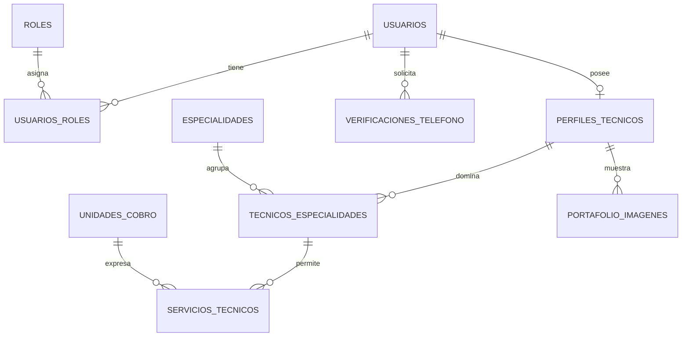
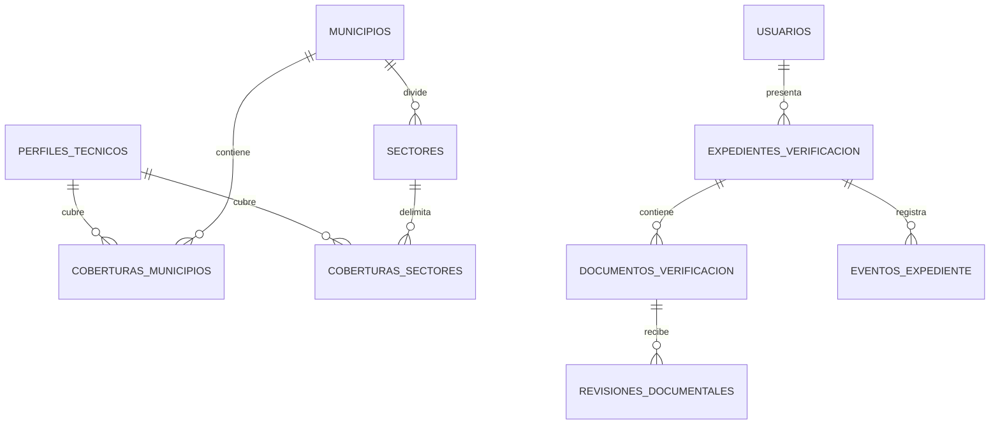

# Modelo de datos de TekniGO — Sprint 1

Estado: propuesta de diseño; todavía no ejecutada en Supabase.

Fuente: «TekniGO Backlog», HU-01 a HU-16 y condiciones transversales. Se anticipa la trazabilidad documental necesaria para HU-17 a HU-19, sin implementar sus operaciones administrativas.

## Decisiones de base

- PostgreSQL almacena datos del negocio. Firebase Authentication administra credenciales y recuperación; no existen columnas de contraseña ni tokens de recuperación en estas tablas.
- Cada usuario tiene un UUID interno y un `firebase_uid` único. Las relaciones usan el UUID interno.
- Decisión confirmada: una cuenta puede tener rol cliente y técnico. Los roles administrativos solo se asignan mediante procedimientos autorizados, nunca desde el registro público.
- UUID para claves primarias; `timestamptz` para instantes; `numeric(12,2)` para tarifas en HNL. No usar `float` para dinero.
- Las tablas mutables incluyen `creado_en` y `actualizado_en`; el servicio mantiene la segunda fecha.
- La baja es lógica: no libera DNI, teléfono ni referencias históricas. Evitar borrados en cascada de usuarios y evidencias.
- FastAPI centraliza acceso y permisos. No se concede acceso directo desde el navegador a las tablas del negocio; las credenciales de base de datos y Storage quedan en el servidor.
- Las migraciones Alembic serán la fuente del esquema. No mantener un segundo esquema independiente creado manualmente desde el panel.

## Identidad y perfil

| Tabla | Campos principales | Integridad |
| --- | --- | --- |
| usuarios | id, firebase_uid, nombre_completo, correo, dni_normalizado, telefono_normalizado, telefono_verificado_en, estado_cuenta, eliminado_en | PK id; UNIQUE firebase_uid, dni_normalizado y telefono_normalizado; datos obligatorios no vacíos |
| roles | id, codigo, nombre | UNIQUE codigo; semillas CLIENTE, TECNICO, ADMIN |
| usuarios_roles | usuario_id, rol_id | PK compuesta; FK a usuarios y roles |
| perfiles_tecnicos | usuario_id, resumen_profesional, experiencia, disponible | PK/FK usuario_id; disponible inicia en false |
| verificaciones_telefono | id, usuario_id, telefono_normalizado, proveedor, referencia_externa, estado, intentos, solicitado_en, vence_en, verificado_en | intentos >= 0; vence_en > solicitado_en; referencia del proveedor sin OTP en texto plano |

`estado_cuenta`: ACTIVA o BAJA. La suspensión administrativa con causa y vigencia será una entidad propia en el sprint correspondiente. ACTIVA no significa identidad verificada ni habilitación para contratar.

El correo se conserva para mostrarlo/contactar al usuario y se sincroniza con Firebase mediante un flujo autorizado; no es la clave de las relaciones. La política de cuentas con el mismo correo depende de la configuración de Firebase y debe fijarse antes del registro.

DNI y teléfono son texto, no números: preservar ceros iniciales. Normalizar antes de persistir. El formato exacto de DNI y países admitidos se define antes de implementar validadores; el teléfono se guarda con código de país en formato canónico.

El cambio de teléfono invalida su verificación en la misma transacción. Un resultado de un desafío antiguo no puede verificar el nuevo teléfono. Cambiar datos de identidad aprobados exige una nueva revisión.

La creación del usuario Firebase y del usuario PostgreSQL no comparte transacción: implementar alta local idempotente por firebase_uid. Si falla por duplicidad de identidad, no permitir operaciones del negocio a una identidad Firebase sin perfil local completo. Definir compensación y reintento sin eliminar una cuenta preexistente.

## Oferta profesional y cobertura

| Tabla | Campos principales | Integridad |
| --- | --- | --- |
| especialidades | id, nombre, nombre_normalizado, activa | UNIQUE nombre_normalizado; sin nombres vacíos |
| tecnicos_especialidades | tecnico_id, especialidad_id | PK compuesta; FK tecnico_id a perfiles_tecnicos |
| unidades_cobro | id, codigo, nombre, activa | UNIQUE codigo |
| servicios_tecnicos | id, tecnico_id, especialidad_id, nombre, descripcion, tarifa_base, unidad_cobro_id, activo | FK compuesta (tecnico_id, especialidad_id) a tecnicos_especialidades; tarifa_base > 0 |
| municipios | id, codigo, nombre | UNIQUE codigo; usar código territorial inequívoco, no nombre globalmente único |
| sectores | id, municipio_id, nombre, nombre_normalizado, activo | UNIQUE (municipio_id, nombre_normalizado); UNIQUE (id, municipio_id) para FK compuesta |
| coberturas_municipios | tecnico_id, municipio_id | PK compuesta; representa TODO el municipio |
| coberturas_sectores | tecnico_id, sector_id | PK compuesta; representa solo ese sector |
| portafolio_imagenes | id, tecnico_id, bucket, objeto, mime_type, tamano_bytes, descripcion, orden, eliminado_en | UNIQUE (bucket, objeto); tamano_bytes > 0; orden >= 0 |

Se usan dos relaciones de cobertura para distinguir explícitamente municipio completo de sectores seleccionados, evitando que NULL tenga un significado ambiguo. Si se selecciona todo un municipio, el servicio elimina sus selecciones de sectores redundantes en una transacción. Un filtro por sector coincide con cobertura de ese sector O de todo su municipio.

La tarifa se exige al publicar un servicio activo. Propuesta: crear el servicio con tarifa y unidad en la misma operación; HU-08 y HU-09 comparten persistencia. Si se requieren borradores sin tarifa, se debe añadir un estado BORRADOR y una restricción condicional antes de implementar.

Una especialidad asociada a servicios no se elimina físicamente. Se desactiva el servicio o la categoría preservando referencias. Los nombres especialidad y categoría se tratarán como un mismo catálogo salvo que el Product Owner distinga ambos conceptos.

## Expedientes y archivos privados

| Tabla | Campos principales | Integridad |
| --- | --- | --- |
| expedientes_verificacion | id, usuario_id, ambito, estado, enviado_en, resuelto_en | UNIQUE (usuario_id, ambito); ambito CLIENTE o TECNICO |
| documentos_verificacion | id, expediente_id, tipo, version, bucket, objeto, mime_type, tamano_bytes, emitido_en, vence_en, cargado_en, eliminado_en | UNIQUE (expediente_id, tipo, version); UNIQUE (bucket, objeto); version > 0; tamano_bytes > 0 |
| revisiones_documentales | id, documento_id, decision, observacion, administrador_id, decidido_en | FK al documento y usuario responsable; rechazo exige observación |
| eventos_expediente | id, expediente_id, estado_anterior, estado_nuevo, actor_id, causa, ocurrido_en | Historial de cambios; actor nulo reservado a procesos del sistema identificados por causa |

Estados del expediente: NO_VERIFICADO, EN_REVISION, APROBADO, RECHAZADO. La interfaz puede mostrar «Pendiente de revisión» para cliente y «En revisión» para técnico con el mismo estado interno.

Tipos de documentos: DNI_FRENTE, DNI_REVERSO, SELFIE, ANTECEDENTES_POLICIALES, ANTECEDENTES_PENALES y CERTIFICACION. Los tres primeros son obligatorios para cliente; los cinco primeros para técnico. Las certificaciones son opcionales y su aprobación no sustituye la verificación de seguridad.

Cada reemplazo crea una versión nueva: las revisiones siguen vinculadas a la versión revisada. Para identidad se usa la versión más reciente no eliminada de cada tipo. Antes de implementar HU-19, separar certificaciones como documentos identificables si se admite más de una del mismo tipo; no tratar dos diplomas diferentes como versiones del mismo diploma.

No guardar URLs públicas o firmadas como identidad del archivo: guardar bucket y objeto. Las URLs autorizadas son temporales. Portafolio y documentos de identidad utilizan almacenamiento y permisos separados.

El titular carga documentos y ve sus estados/observaciones; solo administración accede al contenido sensible. La consulta de expediente no devuelve enlaces de descarga al titular. Validar tamaño, tipo real y permisos en el servidor. La selfie debe originarse en captura en vivo; una columna no demuestra ese requisito, que exige un flujo de captura y validación.

El envío de expediente y su evento se guardan en una transacción tras verificar todos los archivos obligatorios. Una carga a Storage no participa en la transacción PostgreSQL: usar objetos temporales y limpieza de huérfanos ante fallos.

## Relaciones

## Consultas, permisos e índices

- Crear índices para FK usadas en búsqueda: especialidades por técnico y técnico por especialidad, servicios por técnico, sectores por municipio, coberturas por zona, expedientes por usuario y documentos por expediente/tipo/versión.
- Listados paginados con orden estable e identificador como desempate.
- Catálogo y habilitación comparten una regla central: identidad y teléfono válidos, disponibilidad y ausencia de restricciones. Antes de cada contratación se vuelve a comprobar; no confiar en el resultado antiguo del catálogo.
- No almacenar un booleano único `habilitado` como fuente de verdad. Más adelante integrar vencimientos, suspensiones y restricción financiera en la regla de elegibilidad.
- Proyección pública separada: no devolver DNI, teléfono, correo privado ni rutas de documentos. Mostrar experiencia, servicios activos, cobertura, portafolio e insignias autorizadas.
- Sin reseñas publicadas, la calificación es null y el conteo cero. No inventar un promedio cero ni añadir reseñas ficticias a usuarios reales.
- La certificación y las reseñas completas llegan después. Para S1, usar únicamente datos ficticios identificados y una semilla restringida al entorno de demo; no añadir un bypass de verificación en la API productiva.

## Trazabilidad y próximos pasos

| Historias | Entidades |
| --- | --- |
| HU-01, HU-02, HU-06, HU-14 | usuarios, roles, usuarios_roles, perfiles_tecnicos |
| HU-03 a HU-05 | Firebase; perfil local y comprobación de permisos en API |
| HU-07 | especialidades, tecnicos_especialidades |
| HU-08 y HU-09 | servicios_tecnicos, unidades_cobro |
| HU-10 | municipios, sectores, coberturas_municipios, coberturas_sectores |
| HU-11 | perfiles_tecnicos.disponible |
| HU-12 y HU-13 | consultas del catálogo y portafolio; futura integración de certificaciones y reseñas |
| HU-15 y HU-16 | expedientes, documentos, eventos; revisiones preparadas para S2 |
| Condición transversal teléfono | verificaciones_telefono y usuarios.telefono_verificado_en |

Orden de implementación: configuración por variables de entorno → conexión SQLAlchemy → modelos → primera migración Alembic → restricciones y semillas de catálogos → registro local idempotente → perfiles/servicios/cobertura → carga documental privada → catálogo.

Pruebas necesarias: duplicados concurrentes de DNI/teléfono; idempotencia de alta; asociación de servicio a especialidad propia; tarifas positivas; cobertura por municipio/sector; invalidación de teléfono; envío documental incompleto; acceso ajeno y exposición pública de datos privados. Ejecutar migraciones primero en una base de pruebas.

Antes de cerrar el esquema completo: confirmar proveedor de validación telefónica, límites/vigencias de archivos y política de correo. La multiplicidad de roles ya está confirmada. Ninguna de estas decisiones autoriza crear administradores desde formularios públicos.

Implementación inicial HU-01 a HU-04: `app/models.py` y migración `001_identity` crean usuarios, asignaciones de roles y perfil técnico. Se usa un código de rol validado en lugar de una tabla de catálogo de roles para estos tres valores fijos. Las demás entidades de este documento siguen siendo diseño propuesto; no están creadas por esa migración. Los campos iniciales `dni` y `telefono` almacenan los valores normalizados. Las posteriores migraciones incorporarán estados administrativos, baja lógica y verificación telefónica sin eliminar la identidad.

Solicitudes, ofertas, pagos, libro financiero, reseñas y chat se incorporarán en migraciones posteriores. Diseñar sus relaciones generales antes de S2, sin implementar todo el backlog dentro de la primera migración.
